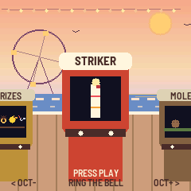
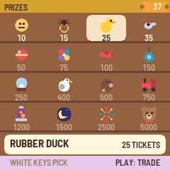
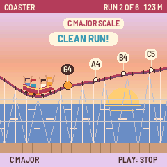
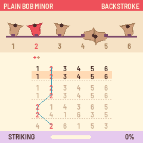
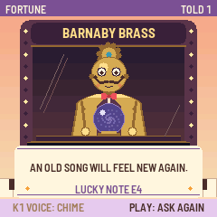
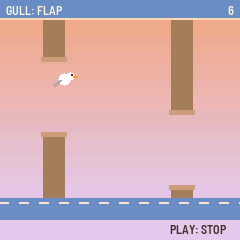

# Boardwalk for the M-VAVE FM-1

Boardwalk turns the M-VAVE FM-1 into a seaside arcade of music games. Walk along the boardwalk at golden hour, the
sea and the gulls behind you, each cabinet playing its own little tune, and step up to one: ring the changes on a
tower's bells, name a note by ear, play a song on falling tiles, fly a gull through a pier's posts, ride a roller
coaster whose track is the melody. Every game pays out tickets, and the prize counter at the start of the row trades
them for prizes, from a sticker to a giant teddy.

  
  

- **Try it in your browser** (no FM-1 needed): <https://charlesvestal.github.io/fm1-boardwalk/emu/>
- **Install it** (Chrome or Edge, with the FM-1 plugged in): <https://charlesvestal.github.io/fm1-boardwalk/install/>
- **Download the firmware file**: [releases](https://github.com/charlesvestal/fm1-boardwalk/releases)

Installing it is at your own risk, though it's hard to get stuck: the web installer can put M-VAVE's own firmware
back, and an FM-1 that fails to start twice comes up in a safe mode the installer can reach.

## Playing

On the boardwalk, **OCT− / OCT+** (or SELECT) walk along the cabinets and **PLAY** steps up to the one in front.
In a game, **PLAY** starts and stops a round, the **keys** play it, **KNOB 1** picks its level or mode, and **HOME**
steps back to the boardwalk. On the boardwalk, KNOB 1 sets the sea and KNOB 2 the cabinets' tunes.

| Cabinet | What it is |
|---|---|
| Prizes | Trade your tickets: sixteen prizes on the white keys, PLAY trades |
| Striker | Ring the bell: strike as the swinging pointer passes the mark asked |
| Moles | Whack the moles as they pop up from the keys; a good run of whacks is a tune |
| Balloons | Hold a key to pump, let go on the ring; past it, a pop you can't see |
| Tiles | Play the song on falling tiles: Ode to Joy, Für Elise, Greensleeves and more |
| Gull | Fly a gull through the pier's posts: flap, hold to climb, or sing your height |
| Ducks | A shooting gallery: each duck quacks its note; play it to hit it |
| Teacups | Tap on the waltz's beat to spin your cup; it never stops speeding up |
| Fortune | Ask Barnaby Brass, the brass seer, a question in notes; he answers in a tune and a card |
| Parrot | Play back what the parrot sings, one more note each time |
| Bumpers | The dodgems: steer with the keys, bump the cars low note to high |
| Echo | Call and response: play back each bar's rhythm on any key |
| Claw | Steer the claw with the keys to the toy the machine wishes for (it plays the toy's note) |
| Pitch | Name the note by ear, or hold a tone in tune against a drifting one |
| Fishing | Cast under a fish, hook it on its note, reel with the tug |
| Chord Code | Hear a chord, find its notes, with marks for right and other octave |
| Coaster | The track is the melody: play each run's notes to keep the train going |
| Bells | Change ringing: ring one bell of a tower's six or eight, a pair as on handbells, or conduct |

Each game keeps its best. A finished round pays tickets, more for playing well and on harder levels, and on the way
out the cabinet feeds them out of its slot. Prizes you trade for sit on the boardwalk's rail; two of them change the
boardwalk itself.

Boardwalk also tells the [FM-1 Screen Reader](https://charlesvestal.github.io/fm1-reader/) what its screen shows,
over USB: the cabinet in front, each game's screen, its knobs as they turn, and what happened.

## Building and testing

Boardwalk is an app on [fm1-base](https://github.com/charlesvestal/fm1-base) (`base/`, a git submodule); clone with
`--recursive`. The toolchain and prerequisites are in [BUILDING.md](BUILDING.md):

```
sh tests/run_tests.sh                                        # every cabinet in a simulator, the web build
./build.sh                                                   # app/build/boardwalk.fwsc
python3 base/tools/fm1_install.py app/build/boardwalk.fwsc   # install it over USB
```

The design notes and decisions are in [NOTES.md](NOTES.md), the first mockups in `mockups/`.

## Credits

Change ringing's methods (Plain Bob, Grandsire, Kent Treble Bob, Cambridge Surprise) are written from the Central
Council of Church Bell Ringers' collection (methods.cccbr.org.uk). The songs are traditional or long out of
copyright. The reverb is Jon Dattorro's plate ("Effect Design, Part 1", JAES 1997), as in
[FoMni-1](https://github.com/charlesvestal/fm1-fomni). Some cabinets are inspired by classic games (Simon, Flappy
Bird, Piano Tiles, Whac-A-Mole) and fairground machines; none of their code, art or names is used. Boardwalk is
built on [fm1-base](https://github.com/charlesvestal/fm1-base) and
[felucca-bsp](https://github.com/hugelton/felucca-bsp), from [Felucca](https://github.com/hugelton/Felucca) by Leo
Kuroshita (Hügelton Instruments). The idea of running FM-1 firmware in the browser comes from
[Groove OS](https://www.groove-os.com/). MPL-2.0; see [LICENSING.md](LICENSING.md).

M-VAVE and FM-1 are trademarks of their owners, as are the games named above. Boardwalk is not affiliated with any of
them or with Hügelton Instruments.
