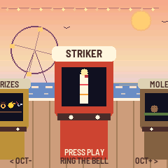
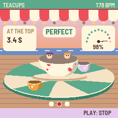
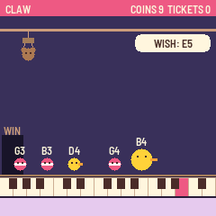
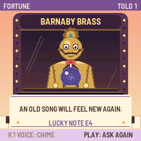

# Boardwalk

Boardwalk turns your M-VAVE FM-1 into a seaside arcade of music games. You walk along the boardwalk at golden hour,
with the sea and the gulls behind you, and each cabinet plays its own little tune. Step up to one to play. You can
ring the changes on a tower's bells, name a note by ear, play a song on falling tiles, fly a gull through a pier's
posts, or ride a roller coaster whose track is the melody. Every game pays out tickets. Trade them at the prize
counter at the start of the row for anything from a sticker to a giant teddy.

This is version {{VERSION}}. Installing is at your own risk, and the installer can put M-VAVE's own firmware back.

- [Try it in the browser](emu/), with sound. It runs the same code as the FM-1, so you don't need one.
- [Install](install/) it from Chrome or Edge, with the FM-1 connected by USB.
- [Download {{PKG}}](firmware/{{PKG}}) to use the command-line installer: `python3 base/tools/fm1_install.py {{PKG}}`.
- [Source](https://github.com/charlesvestal/fm1-boardwalk) is under MPL-2.0. It's built on fm1-base and felucca-bsp,
  from Felucca by Leo Kuroshita, Hügelton Instruments.

## Playing

On the boardwalk, press **OCT− / OCT+** (or turn SELECT) to walk along the cabinets, and press **PLAY** to step up to
the one in front of you. In a game, press **PLAY** to start and stop a round, and play it on the **keys**. Turn
**KNOB 1** to pick the game's level or mode, and press **HOME** to step back onto the boardwalk. On the boardwalk
itself, KNOB 1 sets the sound of the sea and KNOB 2 the cabinets' tunes.

| Cabinet | What it is |
|---|---|
| Prizes | Trade your tickets. Pick one of sixteen prizes on the white keys and press PLAY to trade |
| Striker | Ring the bell. Strike as the swinging pointer passes the mark you're asked for |
| Moles | Whack the moles as they pop up from the keys. A good run of whacks plays a tune |
| Balloons | Hold a key to pump, and let go on the ring. Somewhere past it is a pop you can't see |
| Tiles | Play the song on falling tiles: Ode to Joy, Für Elise, Greensleeves and more |
| Gull | Fly a gull through the pier's posts. Flap, hold to climb, or sing your height |
| Ducks | A shooting gallery. Each duck quacks its note, and you play that note to hit it |
| Teacups | Tap on the waltz's beat to spin your cup. It never stops speeding up |
| Fortune | Ask Barnaby Brass, the brass seer, a question in notes. He answers with a tune and a card |
| Parrot | Play back what the parrot sings. It adds one more note each time |
| Bumpers | Drive the dodgems. Steer with the keys and bump the cars low note to high |
| Echo | Call and response. Play back each bar's rhythm on any key |
| Claw | Steer the claw with the keys to the toy the machine wishes for. It plays the toy's note |
| Pitch | Name the note by ear, or hold a tone in tune against one that drifts |
| Fishing | Cast under a fish, hook it on its note, and reel it in with the tug |
| Chord Code | Hear a chord and find its notes. Marks show a right note and one in another octave |
| Coaster | The track is the melody. Play each run's notes to keep the train going |
| Bells | Change ringing. Ring one bell of a tower's six or eight, ring a pair as on handbells, or conduct |

Each game remembers your best. When you finish a round, it pays tickets, and you get more for playing well and on
harder levels. As you leave, the cabinet feeds them out of its slot. The prizes you trade for sit on the boardwalk's
rail, and two of them change the boardwalk itself.

Boardwalk also tells the [FM-1 Screen Reader](https://charlesvestal.github.io/fm1-reader/) what its screen shows,
over USB.

To go back to the official firmware, use "Back to the stock firmware" in the installer, or M-VAVE's own updater,
M-UPGRADE, from [m-vave.com/download](https://www.m-vave.com/download).

Change ringing's methods are written from the Central Council of Church Bell Ringers' collection. The songs are
traditional or long out of copyright. Some cabinets are inspired by classic games (Simon, Flappy Bird, Piano Tiles,
Whac-A-Mole), but none of their code, art or names is used. M-VAVE and FM-1 are trademarks of their owners, as are the
games named. Boardwalk is not affiliated with any of them.
